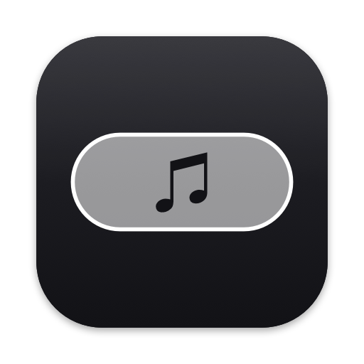

<p align="center">
  
</p>

# LyricPill

Show the current **time-synced lyric line** of whatever Spotify is playing as a small,
always-on-top, click-through pill on your screen — with optional **on-device translation** into
your language.

One native macOS menu-bar app. Swift + AppKit, **zero third-party dependencies**, no accounts,
no API keys, no telemetry. Free and open source (MIT).

[](https://github.com/theranjithjayaram/lyric-pill/actions/workflows/ci.yml)
· [Website](https://theranjithjayaram.github.io/lyric-pill/)
· [Latest release](https://github.com/theranjithjayaram/lyric-pill/releases/latest)

## Features

- **Lyric pill** — always on top, click-through, drag it anywhere (Move Mode); position, font
  size and opacity are remembered.
- **Modes** — *Auto* (show only while a synced line is playing), *On*, *Off*.
- **Translation** (macOS 15+) — lyrics are translated **entirely on your Mac** with Apple's
  Translation framework. Pick the language you read and any number of source languages; the app
  tells you which language packs are installed and downloads the missing ones on request.
  Translated lines are marked with a monochrome `⇄`. Lines the app can't attribute to an enabled
  language are left untouched — mixed-language uploads stay correct.
- **Launch at login**, standard macOS login item (visible in System Settings).
- **Honest status** — the menu says exactly what's happening: showing lyrics, no synced lyrics
  for this track, lyrics server unreachable, language pack missing.
- **Weightless** — no polling, no periodic timers while idle, network only when a *new* song
  starts (results cached). Measured ≈ 55 MB RAM, ≈ 0.3 % CPU while playing.

## Install

### From the DMG (recommended)

1. Download `LyricPill-x.y.z.dmg` from the
   [latest release](https://github.com/theranjithjayaram/lyric-pill/releases/latest).
2. Open it and drag **LyricPill** to **Applications**.
3. Open LyricPill. It lives in the menu bar (♫) — there is no Dock icon. The Settings window
   opens the first time so you can set *Launch at login* and translation.
4. Play a song in Spotify. macOS asks once *"LyricPill would like to control Spotify"* —
   click **Allow**. (It is only used to read the current track and position.)

**Gatekeeper.** Releases are signed and notarized when the maintainer's Apple Developer
credentials are configured — the release notes say so. If a release is marked *not notarized*,
macOS shows *"Apple could not verify LyricPill is free of malware"* on first open. Either:

- click **Done**, then System Settings → **Privacy & Security** → scroll to *Security* →
  **Open Anyway** (once); or
- in Terminal: `xattr -dr com.apple.quarantine /Applications/LyricPill.app`; or
- verify the checksum and build it yourself (below).

Every release ships a `.sha256` file:
`shasum -a 256 -c LyricPill-x.y.z.dmg.sha256`.

### From source

```bash
git clone https://github.com/theranjithjayaram/lyric-pill.git
cd lyric-pill
./install.sh      # swift build → /Applications/LyricPill.app (ad-hoc signed) → open
```

Needs Xcode Command Line Tools with Swift 6+ (`xcode-select --install`).

### Requirements

- macOS 13 Ventura or later (Apple silicon or Intel). Translation needs **macOS 15** Sequoia.
- Spotify desktop app.

## Settings

Menu ♫ → **Settings…** (or ⌘, while the menu is open).

| Tab | What's there |
| --- | --- |
| **General** | Overlay mode · Launch at login · Spotify automation status (with a shortcut to the Automation privacy pane) · Pill font size & opacity · Reset position |
| **Translation** | Translate on/off · *Translate into* (your language) · *Translate from* — one row per language with **Installed ✓ / Download… / Unavailable**, plus a shortcut to macOS's Translation Languages pane |
| **About** | Version · **Check for Updates…** (on demand only) · links to this repo, issues, privacy, license |

### How translation decides what to translate

Everything is rule-based and happens per line:

1. The line's dominant script is detected (Devanagari, Arabic, Cyrillic, Han, Kana, Hangul,
   Thai, Latin, …).
2. If exactly one *enabled* source language uses that script, the line goes to that model
   (e.g. Devanagari → Hindi).
3. If several do (Cyrillic → Russian/Ukrainian, Latin → French/Spanish/…), Apple's on-device
   language recognizer is asked; if it isn't confident the line is one of them, the line is left
   alone.
4. Output must come back in the target language's script, or the original line is kept.

Supported languages are whatever Apple's framework offers on your macOS version — currently
Arabic, Chinese (Simplified/Traditional), Dutch, English, French, German, Hindi, Indonesian,
Italian, Japanese, Korean, Polish, Portuguese, Russian, Spanish, Thai, Turkish, Ukrainian and
Vietnamese. Languages Apple doesn't ship (e.g. Tamil, Punjabi, Bengali) and *romanized* lyrics
cannot be translated by anything on-device and are shown as uploaded.

Language packs are downloaded and stored by macOS, shared with other apps, and manageable in
System Settings → General → Language & Region → Translation Languages.

## How it works

```
Spotify ──"PlaybackStateChanged" notification──► LyricPill (menu-bar app)
   ▲                                                  │
   └── Apple events (track, position, play state) ◄───┤
                                                      │
                lrclib.net ──HTTPS──► synced LRC (disk-cached per song)
                                                      │
                 timing engine picks the active line  │
                                                      ▼
                    borderless click-through NSPanel (the pill)
```

- **Lyrics** come from [lrclib.net](https://lrclib.net) (artist + title + album + duration):
  exact lookup, then a search fallback, then a last-resort search with annotation suffixes
  (`(From "Movie")`, `(feat. X)`) stripped — duration-gated so the wrong song can't match.
  Results are cached under `~/Library/Caches/lyric-pill/`; misses expire after 24 h so new
  releases get re-checked; server outages are never cached.
- **Timing**: playback position is interpolated with a monotonic clock and re-synced every
  10 s while playing. One timer is armed for exactly the next line boundary — no tick.
- **Idle**: paused, Spotify closed, or mode Off ⇒ zero timers, zero polling.

## Troubleshooting

| Symptom | Check |
| --- | --- |
| "Apple could not verify…" on first open | See *Gatekeeper* above. |
| Overlay never appears | Menu ♫ → status row. In Auto mode a track without synced lyrics shows nothing (expected). |
| Status says *Spotify: …* / Settings says *Denied* | System Settings → Privacy & Security → **Automation** → LyricPill → allow Spotify. |
| Every song: *Lyrics server unreachable* | lrclib.net is down or blocked; nothing is cached, new tracks fetch fresh once it recovers. |
| Status says *… pack not downloaded* | Settings → Translation → **Download…** next to that language. |
| Launch at login won't turn on | Only an installed `.app` can register; `swift run` can't. If it says *requires approval*, allow it in System Settings → General → Login Items. |
| Stale lyrics suspected | `rm -rf ~/Library/Caches/lyric-pill/` |

## Uninstall

Quit LyricPill (menu ♫ → Quit), drag `/Applications/LyricPill.app` to the Trash, and optionally:

```bash
rm -rf ~/Library/Caches/lyric-pill
defaults delete io.github.theranjithjayaram.lyric-pill
```

From a source checkout, `./uninstall.sh` does all of it. Language packs belong to macOS
(System Settings → General → Language & Region).

## Development

```bash
swift build && swift run lyrics-tests                      # unit tests (pure-logic module)
swift run LyricPill --simulate examples/sample.lrc --settings   # overlay + settings, no Spotify
swift run LyricPill --translate-check examples/mixed-script-sample.lrc
swift run LyricPill --engine-check examples/sample.lrc
scripts/build-app.sh && scripts/make-dmg.sh build/LyricPill.app build/LyricPill-dev.dmg
```

Tests are a plain executable because Command Line Tools ship neither XCTest nor Swift Testing.
See [CONTRIBUTING.md](CONTRIBUTING.md), the decision log in [docs/CONTEXT.md](docs/CONTEXT.md),
and the [release process](docs/release-process.md).

## Privacy & security

To find lyrics the app sends the playing track's **artist, title, album and duration** to
lrclib.net over HTTPS — nothing else, ever. Translation runs on-device. *Check for Updates…*
contacts GitHub only when you click it. No analytics, no accounts, no telemetry.
Details: [PRIVACY.md](PRIVACY.md) · [SECURITY.md](SECURITY.md).

## Legal

- Not affiliated with, endorsed by, or sponsored by Spotify. LyricPill talks to the Spotify
  desktop client only through Spotify's own public AppleScript interface.
- Lyrics are fetched at runtime from [lrclib.net](https://lrclib.net), a community lyrics
  service; no lyrics are bundled or redistributed by this project. Lyrics remain the property of
  their rights holders.
- Translation uses Apple's Translation framework; language packs are Apple's.
- Code: MIT — see [LICENSE](LICENSE).
